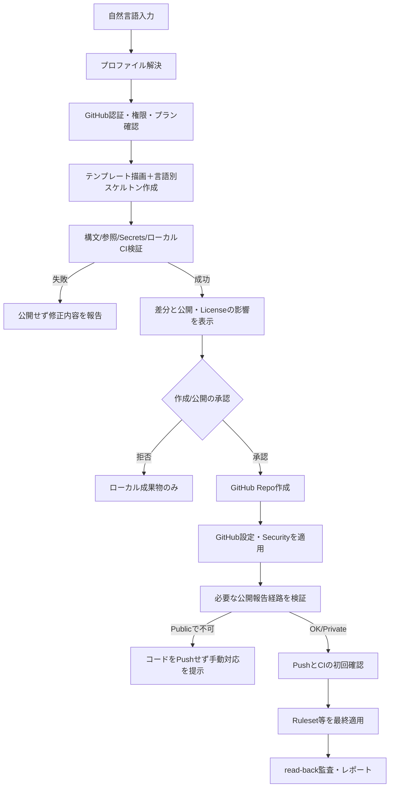

<!-- 設計書 DESIGN.md（1.0-draft）の規範部（§0〜§13、付録A）を移設したもの。テンプレート本文（付録B・C）は assets/templates/ にある。実装で変えた点は CHANGES.md を参照。 -->

# repo-bootstrap — Agent Skills 設計書

**版**: 1.0-draft / **作成**: 2026-11-14 / **対象**: GitHub.com・個人アカウント・GitHub Freeを第一ターゲット  
**目的**: 新規GitHubリポジトリを、安全で保守可能な標準構成として短い自然言語指示から生成する。Public/Privateと文書言語（日本語・英語・日英両方）を一次パラメータにする。

> 本パッケージは**実装前の設計書と具体的なテンプレート資産**であり、動作するAgent Skillをインストールしたものではない。`templates/` の全ファイルには実際の内容を記述済み。`examples/SKILL.sample.md` は実装用の雛形であり、スクリプトは未実装。

## 0. 設計判断の要約

- **Agent Skills標準**の `SKILL.md`＋`scripts/`＋`references/`＋`assets/` 構成を採用。特定のAIへの依存を最小化し、Codexを優先利用環境とする。
- **決定性を重視**する。AIは意図の解釈・例外判断・説明を担当し、ファイル描画とGitHub APIの実行は決定的なスクリプトに委任する。
- **入力の第一軸は `docs_locale`（`en` / `ja` / `both`）と `visibility`（`public` / `private`）**。これは実装言語の指定（`project_type`）とは独立した軸。
- **標準利用は個人Free/Public**。新規作成時には事前にローカル生成・検証を終える。Private/Freeでは利用不可なGitHub機能を黙って省略せず、用途の異なる代替検査を導入して差分を報告する。
- 生成したREADME・AGENTS・SECURITY・CONTRIBUTING・PRテンプレートには**実内容**を入れる。単に見出しだけの空文書を作らない。文言は同梱テンプレートに固定し、環境依存項目だけ差し込む。
- **検証していない設定を有効扱いにしない**。書き込み成功レスポンスと設定のread-back検証は別ステップ。
- CodeQLはPublic/Freeなら**Default setup**を優先。特殊なビルドが必要な場合のみAdvancedへ移行。CodeRabbitはGitHub Appの導入権限を別扱い。
- **GitHub Actionsは最小権限・サードパーティActionをフルコミットSHA固定**。生成前に信頼できるリリースタグからSHAを解決し、解決できなければ該当CI生成を停止する。

## 1. 要求定義

### 1.1 必須機能（MUST）

1. 対話または構造化入力から、リポジトリ名、言語モード、公開範囲、プロジェクト種別を解決する。省略可能値は標準値を使い、毎回細かく質問しない。
2. `plan`（表示のみ）、`create`（新規）、`adopt`（既存へ非破壊的適用）、`verify`（監査）、`repair`（失敗箇所を修復）の5モードを提供する。
3. 出力は実行可能な開発用スケルトンと、README、AGENTS、SECURITY、CONTRIBUTING、PRテンプレート、`.gitignore`、`.editorconfig`、`.gitattributes`、CI、Dependabot設定を含む。
4. 自然言語の3モードを、READMEだけでなく、AGENTS・SECURITY・CONTRIBUTING・PRテンプレートにも反映する。
5. 個人GitHub Freeを想定して機能可否を判定し、Privateは安全な代替を提供する。無効化できないGitHub制約は明示する。
6. コミット・Push・公開・Licenseの付与・GitHub設定変更には操作の影響を事前提示し、適用権限を確認する。
7. 作成後にCIの初回稼働とGitHub設定を監査し、適用済み／検証済み／非対応／手動操作／失敗を機械判読可能な形式で出す。

### 1.2 非機能要件

- **冪等性**: 同じ入力で再実行しても重複・破壊・内容消失を発生させない。
- **再現性**: テンプレート版・GitHub API適用内容・Actionの固定SHAを記録する。
- **移植性**: Windows 11 + PowerShell、WSL2 Ubuntu、macOS/Linuxで同等に動くPython 3.11+ CLIを標準実装。`gh` と `git` は外部依存。
- **秘密保持**: 設定値やログにSecretの中身を残さない。テンプレートに資格情報を含めない。
- **保守性**: `SKILL.md` は短く、規約やソースは段階的に読み込ませる。コマンド仕様はテストで検証する。
- **ネットワーク障害耐性**: GitHub APIの一時エラーは限定回数再試行、操作結果を読み戻し、ローカル成果物は保持する。

### 1.3 対象外（v1）

- GitHub Enterprise Server、組織横断のポリシー、課金操作、権限昇格、GitHub Appの無断インストール。
- 既存コードの大規模な移行、既存CIの自動削除、無断での公開範囲変更。
- AIによるREADMEの任意な作文・根拠のない機能説明。
- Freeプランで提供されないGitHubネイティブのCode Scanning/Rulesetsを、代替ツールで「同等の機能」と称すること。

## 2. 入力モデルとデフォルト

### 2.1 パラメータ

| キー | 型・値 | デフォルト | 備考 |
|---|---|---|---|
| `owner` | GitHubユーザー名 | `gh api user -q .login` | 個人所有であることを確認 |
| `name` | 正規化されたリポジトリ名 | **必須** | 不適切な名前は拒否し勝手に変更しない |
| `description` | 文字列 | `{{name}} project` | README概要はコードから推論せず保守的に記述 |
| `docs_locale` | `en`, `ja`, `both` | Publicでは`both`、Privateでは`ja` | 指示があれば優先 |
| `visibility` | `public`, `private` | `public` | 公開前に意図を確認 |
| `project_type` | `rust`, `python`, `node`, `java-maven` | 入力・既存資産から判定 | 不明なら `generic`（文書のみ） |
| `repo_kind` | `oss`, `personal`, `internal` | Public: `oss`、Private: `internal` | 機能とREADMEの語句に利用 |
| `license` | `MIT`, `none`（`Apache-2.0`はPhase 3） | Public OSS: `MIT`、他: `none` | Publicだからといって必ずOSSではない。License付与を確認 |
| `default_branch` | branch | `main` | 変更は既存Repoに強制しない |
| `coderabbit` | `auto`, `on`, `off` | `auto` | App未導入なら手動操作に分類 |
| `codeql` | `auto`, `on`, `off` | `auto` | PublicでDefault setupを有効化 |
| `secret_scan` | `auto`, `on`, `off` | `auto` | PrivateではGitleaksを追加 |
| `ruleset` | `safe-default`, `strict`, `off` | `safe-default` | `strict`のみPR必須、approval数は個人で0 |
| `security_contact` | `private-reporting`, `email`, `existing-channel` | Public: `private-reporting` | 秘密の報告先が成立しなければPublic公開処理を停止 |
| `ci` | `auto`, `on`, `off` | `auto` | コードがないgenericではスキップ |
| `secrets` | secret名の配列 | 空 | 値は別途、安全な経路からのみ投入 |
| `dry_run` | boolean | `true` for plan | `create`は承認後のみ副作用 |

`description` などが未指定でも、アプリケーションの機能をでっち上げない。`generic` では「リポジトリの標準構成を管理する場所」とだけ記述して実行コマンドを埋めない。

### 2.2 入力例

```yaml
schema_version: 1
owner: tsunyan
name: pilc
description: Clipboard history CLI
docs_locale: both
visibility: public
project_type: node
repo_kind: oss
license: MIT
codeql: auto
coderabbit: auto
ruleset: safe-default
secret_scan: auto
```

> ここにある `owner: tsunyan` は利用例。実装は認証済みアカウントを優先し、所有者を固定しない。

### 2.3 6通りのメインプロファイル

| `docs_locale` | `public` | `private` |
|---|---|---|
| `ja` | 全文書が日本語。CodeQL・Public用Securityを設定 | 全文書が日本語。Free用Secret/SAST代替を検討 |
| `en` | 全文書が英語。同上 | 全文書が英語。同上 |
| `both` | 日英両方。READMEを別ファイル、他は同一ファイル内で併記 | 日英両方。非対応機能の制約も両言語で記載 |

**日英併記の規則**:

- `README.md`: 日本語版、`README.en.md`: 英語版。冒頭に相互リンク。GitHubでトップに表示されるREADMEは日本語。
- `AGENTS.md`, `SECURITY.md`, `CONTRIBUTING.md`, `.github/PULL_REQUEST_TEMPLATE.md`: GitHubやエージェントが読む固定ファイル名を維持するため、**1ファイル内に日本語と英語の完全なセクションを持つ**。両言語の意味が一致することを検査する。
- GitHub Issue formsは `label`/`description` の文言を「日本語 / English」と併記する。
- CodeRabbitレビュー言語は `en` → `en-US`、`ja`・`both` → `ja-JP` を標準とする（変更可能）。
- **コードの識別子・API名・パス・CLIコマンドは翻訳しない**。プログラミング言語の予約語や設定名は原文維持。
- モード変更では、残存する旧言語ファイルを自動削除せず差分を提示する。

## 3. 標準ファイル一覧と実際の内容

本設計書に同梱された `templates/` は**見出しだけのダミーではなく、完成した本文テンプレート**である。各 `*.tpl` は差込変数を展開して最終ファイル名に変換する。

### 3.1 文書（`en`/`ja`/`both`の各フォルダー）

| 生成先 | テンプレート | 内容 |
|---|---|---|
| `README.md` | `<locale>/README.md.tpl` | 名称、説明、概要、要件、導入、実行、開発、セキュリティ、ライセンス |
| `README.en.md` | `both/README.en.md.tpl` | 日英併記モード専用の英語版 |
| `AGENTS.md` | `<locale>/AGENTS.md.tpl` | エージェントの変更原則、実行コマンド、セキュリティ境界、文書言語、完了条件 |
| `SECURITY.md` | `<locale>/SECURITY.md.tpl` | サポート対象、非公開の脆弱性連絡経路、必要情報、対応範囲と免責 |
| `CONTRIBUTING.md` | `<locale>/CONTRIBUTING.md.tpl` | 相談、テスト、PR規約、受け入れ基準 |
| `.github/PULL_REQUEST_TEMPLATE.md` | `<locale>/PULL_REQUEST_TEMPLATE.md.tpl` | 概要、変更、検証、関連Issue |

- **README**: `{{PROJECT_OVERVIEW_*}}` を、依頼文や既存ソースに裏付けられた文章に置換する。推測しかない場合は機能を断言せず「開発用のスターター構成です」と書く。
- **AGENTS**: 不必要に巨大化させない。READMEを読むこと、基本のビルド・テスト、変更範囲、セキュリティ境界、検証報告を常に含む。個人ユーザー固有のChatGPT会話設定は持ち込まない。
- **SECURITY**: PublicはまずGitHubのPrivate vulnerability reportingを有効化・検証し、そのリポジトリのSecurity > Advisoriesから非公開報告する手順を挿入。無効化のままで連絡先もない場合は未完了として公開を止める。Privateは`existing-channel` の連絡経路を明示し、Private repoに存在しない公開報告ボタンを案内しない。
- **CONTRIBUTING**: 最低限の品質基準を含む。実際に存在しないテストコマンドを記述しない。
- **PRテンプレート**: セキュリティ・互換性・テスト観点を含むが、長大なチェックリストにはしない。

### 3.2 設定ファイル（`templates/common/`）

| 生成先 | 中身・ルール |
|---|---|
| `.gitignore` | `.gitignore.base`と言語差分を結合。秘密ファイル/IDE/ビルド生成物を除外する。既存のignoreは温存 |
| `.gitattributes` | LFと主要バイナリ判定、PowerShellスクリプトのCRLF指定 |
| `.editorconfig` | UTF-8、LF、末尾改行、言語別インデント |
| `.github/dependabot.yml` | GitHub Actionsと対象言語のパッケージ更新。週1回・PR数制限・minor/patchまとめ |
| `.coderabbit.yaml` | `coderabbit` 有効かつGitHub App利用可能なら生成。v2スキーマ、レビュー言語、chill、draft非対象 |
| `LICENSE` | `license=MIT` なら同梱の**MITライセンス全文**を生成。`Apache-2.0`はPhase 3で正式なライセンステキストを同梱・検証するまでは明示エラーとする |
| `.repo-bootstrap.yml` | 再現可能な非秘密の設定を記録 |
| `.repo-bootstrap.lock.json` | Skillバージョン、各生成物の直前ハッシュ、利用したAction SHA、GitHub設定の期待状態を保存。秘密値は保存しない |
| `.github/ISSUE_TEMPLATE/bug_report.yml` | 非公開のセキュリティ報告を誘導する文と、再現手順・期待動作・バージョンを含むIssue form。`templates/common/issue-bug.yml.tpl` と `templates/common/issue-i18n.json` で言語別の文字列を埋める |

### 3.3 CI（`templates/ci/`）

| `project_type` | コマンド | バージョン・生成条件 |
|---|---|---|
| `rust` | `cargo fmt --all -- --check`、`cargo clippy --all-targets --all-features --locked -- -D warnings`、`cargo test --all-targets --all-features --locked`、`cargo build --locked` | `cargo new` による実コードを同梱。`Cargo.lock`を生成・コミット |
| `python` | `python -m pip install -e '.[dev]'`、`ruff check .`、`ruff format --check .`、`pytest -q`、`python -m build` | `pyproject.toml`、`src/`、`tests/` を一緒に作る。ビルドできる最小パッケージ |
| `node` | `npm ci`、`npm run lint`、`npm test`、`npm run build` | `package.json`・`package-lock.json`・実在するscriptsとテストを生成。`npm ci`が通ること |
| `java-maven` | `mvn --batch-mode --no-transfer-progress verify` | Java LTSと妥当なMaven標準ディレクトリ。Spring Bootは明示指定時のみ追加 |
| `generic` | なし | `CI skipped: no runnable project` と記録 |

**CI設計上の重要事項**:

1. GitHub Actionsの `uses:` は**フル40桁コミットSHA**を生成時に決定する。テンプレート内の `{{ACTION_*_SHA}}` を残したままPushしない。
2. マーケットプレイスの最新タグ名をそのまま信頼しない。指定の公式Actionリポジトリと許可済みリリースタグからSHAを取得し、必要なら注釈付きtagを解決する。解決エラーはfail closed。依存更新はDependabotで監視。
3. `permissions: contents: read` を既定にし、必要なJobだけ追加権限。秘密値をPRから実行するジョブに渡さない。
4. `pull_request_target` で未信頼PRコードを実行しない。PRイベントは通常の `pull_request` を使う。
5. GitHubのActionsワークフロー式 `${{ github.ref }}` は**テンプレート変数ではない**。置換器は `{{UPPER_SNAKE_CASE}}` のみを認識して、他の二重中括弧を変更しない。
6. `on:` のYAML解析にはGitHub Actionsの構文を正しく扱えるパーサを使う（一般的なYAML 1.1パーサは`on`をboolean扱いすることがある）。
7. `CI`で必要なマニフェストやlockfileが欠けるなら、緑色にするため検査をスキップするのではなく、生成工程を失敗させる。
8. CIのステータスチェック名は**最初のPR/Pushの成功後**にread-backし、後からRulesetへ必須として指定できる（Free Publicのみ）。新規初回Pushを阻害するルールを先行適用しない。

### 3.4 明示的に生成しないもの

- `.env` 本体、実Secret値、`.npmrc`の認証トークン、秘密鍵。
- 無根拠な `CHANGELOG.md`（最初のリリースで生成）、SBOM（配布方針決定時に有効化）、Deployment設定（対象クラウド指定がある場合のみ）。
- 有償・契約が必要なセキュリティ製品の設定を、利用可能だと偽って生成すること。

## 4. GitHub Free・個人アカウント対応表

> 以下は2026-11-14時点のGitHub公式ドキュメントを基準とする。プランと公開範囲を推測で固定せず、実際のAPI応答とread-backで有効化状態を検証する。

| 機能 | 個人Free / Public | 個人Free / Private | 本SkillのPrivateフォールバック |
|---|---|---|---|
| GitHub Actions | 利用可能 | 利用可能（無料枠の消費に注意） | 重い定期Jobを抑制 |
| Dependabot Alerts | 利用可能（有効化が必要な場合あり） | 利用可能 | 原則そのまま有効化 |
| Dependabot Security Updates | 利用可能 | 利用可能 | 原則そのまま有効化 |
| Dependabot Version Updates | 利用可能 | 利用可能 | `dependabot.yml`を共通利用 |
| CodeQL Code Scanning | 利用可能 | **Free個人では不可** | 標準Lint・テスト・任意のSemgrepローカル規則。**同等ではない** |
| Secret Scanning（GitHubネイティブ） | 公開リポジトリ対象の無料機能 | **Free個人Privateでは不可** | Gitleaks Action＋ローカルのpre-commit/pre-push（任意） |
| Repository Push Protection | Publicで有効化を試みる | Privateは同等のリポジトリ強制機能なし | GitleaksによるPush後/PR時の検出。Push自体を完全に防ぐものではない |
| Rulesets / Branch protection | Free Publicで利用可能 | **Free Privateでは不可** | ローカルフックやPR運用（GitHub側で強制できない） |
| Dependency Review Action | Free Publicで利用可能 | GitHub Code Security非契約では不可 | Dependabot Alerts / パッケージ監査（変更差分レビューとは異なる） |
| Private vulnerability reporting | Publicリポジトリで有効化可能 | Public向け機能を前提にしない | 既存の非公開連絡経路をSecurityに記載 |
| CodeRabbit | GitHub App/CodeRabbit側の許可・プランに依存 | 同左。外部へのコード送信可否を必ず確認 | `manual_action` / 明示的無効化。無断導入はしない |

**注意**: GitHub個人アカウントの「Push protection for users」はPublicへの誤Pushを防ぐ個人機能で、PrivateのGitHubリポジトリレベルPush Protectionと同一ではない。フォールバックは差を明示する。

### 4.1 Private Freeの具体的な差し替え

- `codeql=auto`: CodeQL APIは呼ばず、`unsupported: codeql/github-hosted-private-free` と記録。言語別Lint/テストを必須化。希望があればSemgrepのローカル/CIルール検査を追加（ネットワーク先にソースをアップロードするクラウド連携は別途承認）。
- `secret_scan=auto`: `.github/workflows/secret-scan.yml`を生成。個人アカウント向けのGitleaks Action v3を**検証済みSHA**で固定し、PR・mainへのPushで走らせる。Actionのライセンス/プライバシー条件を確認。失敗した検査の内容を外部公開しない。
- `ruleset=safe-default`: 利用不可であることを `unsupported` と記録。Protected mainを**GitHubが強制するわけではない**と明示する。
- `dependency_review`: PR差分のGitHubネイティブチェックは省略し、Dependabot Alerts/Version Updatesは継続。有効化できるAudit CLIはオプション（Rust: cargo-audit、Python: pip-audit、Node: npm auditなど）。
- `coderabbit=auto`: Privateコードを外部サービスに提供するため、自動で導入せず利用可否・データ取り扱い・Appアクセスを確認する。Appが未導入なら `manual_action`、望まなければ `skipped_by_policy`。
- **秘密検出と脆弱性検出は異なる**。GitleaksだけでCodeQLの代わりにはならない。両者を混同しない。

## 5. GitHub API適用仕様

### 5.1 ローカル生成前の事前点検

- `git --version`、`gh --version`、`gh auth status`、`python --version`を確認。
- `gh api user`でログイン中ユーザーを確定し、指定Ownerへの作成権限を検証。
- `gh repo view OWNER/NAME --json ...`等で既存Repoの有無を確認。既存Repoは`create`を中断して`adopt`を提案。
- Repo名をホワイトリスト検査する（`^[A-Za-z0-9_.-]+$` など）。パス区切り、相対パス、シェルメタ文字を拒否。名前衝突時に自動採番しない。
- 対象ディレクトリは空ディレクトリか、安全な既存Gitワークツリーであることを確認。
- `visibility=public`なら、ソースが意図せず公開されないかローカルGitleaks検査を先に実行する（使用不可なら公開処理を停止）。

### 5.2 APIアダプタ

API仕様は`GitHubClient`に閉じ込め、`gh api`を基本にする。実装時にGitHub公式REST APIのバージョン・パラメータ・権限を照合し、ハードコードされた未確認のAPIフィールドを使わない。

| 操作 | 参考API / gh | 成功検証 |
|---|---|---|
| 新規作成 | `gh repo create OWNER/REPO --public` または `--private` で**空Repoを先に作成**し、その後 `git remote add` と `git push` を明示的に分ける。「空Repo作成 → 設定適用 → Push」を必須の順序とする | `GET /repos/{owner}/{repo}` |
| Merge方式・自動削除 | `PATCH /repos/{owner}/{repo}` (`allow_squash_merge`, `delete_branch_on_merge`等) | 再GET |
| Dependency graph / Dependabot / secret scanning / push protection | `PATCH /repos/{owner}/{repo}`の現行`security_and_analysis`等。機能ごとに権限と対応を検出 | 再GET＋必要ならUI確認 |
| CodeQL Default setup | `PATCH /repos/{owner}/{repo}/code-scanning/default-setup` / `GET` | `state=configured`かつ実ジョブ実行 |
| Private vulnerability reporting | GitHub Security機能の対応API/GUI。環境がAPI非対応なら手動操作とし、公開条件に加える | 設定＋Advisoriesの非公開報告導線 |
| Ruleset | `POST /repos/{owner}/{repo}/rulesets` / 一覧取得 | `enforcement=active` と規則内容確認 |
| Actions workflow | YAMLをPush | ワークフロー一覧・初回runの終了状態 |
| Secrets | `gh secret set ... --repo OWNER/REPO`等。値はsecure stdin / 対話環境から | **名前と存在のみ**。値は表示・取得不可 |
| CodeRabbit App | インストール・対象Repoの認可はGitHub App側で実施 | GitHub Appのアクセス権＋CodeRabbitレビュー実績を確認 |

### 5.3 GitHub設定ポリシー

- `main`、Squash merge有効、必要がなければMerge commitを無効、`delete_branch_on_merge=true`、`GITHUB_TOKEN`は読み取り最小権限。
- Rulesetsの`safe-default`（実装ではASCIIの`safe-default`）: `main`の削除・Force Push禁止、必要ならLinear history。**個人の単独開発でPR必須/自己承認必須を標準にしない**。
- `strict`: PR経由の変更と、CIが存在・成功したステータスチェックを要求する。個人で1承認を必須化すると自己承認できず詰まる可能性があるため、Review countは初期値0。適用後にブランチ操作を実際にテストする。
- `required_status_checks`は現存し成功したCIチェックを収集してから適用する。初回CIを走らせる前に見込み名で登録しない。
- ActionsフォークPRにSecretsを渡さない。OIDCはクラウド接続を作るときに別モードで導入。
- 既存RepoのRulesetは上書きしない。Skill管理対象と識別できるものだけ更新し、その他は衝突として報告。
- GitHub Appの管理者権限・外部通信に関する操作は個別に許可を取る。

## 6. 処理フロー・失敗時の扱い



- `create`: **ローカルで検査が終わるまでremoteを作成しない**。Publicは公開後すぐ見えるため、実コードのPush前に脆弱性報告経路など必要な設定を適用する。
- 外部操作（Repo作成/公開/License付与/権限付与）は必ずユーザーの意図と照合。承認を取らず「公開」しない。
- CIの検証はActions runの `conclusion` を確認。非同期処理が完了していなければ `pending` と表示し、成功扱いしない。
- APIのHTTP 403/404/422を全て「未契約」とは解釈しない。権限不足・対象なし・構文エラーも区別する。
- 一時的な 429/5xx は`Retry-After`等を尊重して限定再試行。同一操作の再実行前にread-backする。
- 作成後のエラー時にRepoを勝手に削除しない。部分完了をレポートし、`repair`で再開できるようにする。
- 人為的編集がある既存ファイルは上書きしない。`lock`の直前ハッシュと現内容を照合し、異なる場合は3-way mergeまたは手動差分を提示。

## 7. 実装モジュール構成

```text
repo-bootstrap/
├── SKILL.md                   # 500行以下を目安とするワークフロー
├── scripts/
│   ├── bootstrap.py           # plan/create/adopt/verify/repair エントリ
│   ├── policy.py              # Profile・機能可否・禁止事項
│   ├── renderer.py            # UPPER_SNAKE_CASEテンプレート描画
│   ├── github_api.py          # gh/APIアダプタとread-back
│   ├── scaffold.py            # Rust/Python/Node/Javaの最小実行コード
│   ├── actions.py             # Actionタグ検証と40桁SHA解決
│   ├── validator.py           # YAML/Markdown/リンク/Secrets/CI検査
│   ├── state.py               # manifest・hash・冪等性処理
│   └── report.py              # JSON/Markdownレポート生成
├── references/
│   ├── DESIGN.md              # 本書の規範部を移設
│   ├── POLICY.md              # Public/Private Freeの権限マトリクス
│   ├── LANGUAGE.md            # en/ja/both生成規則
│   └── GITHUB_API.md          # 実装時に照合したREST API契約
├── assets/
│   └── templates/             # 同梱 templates/* を移設
└── tests/
    ├── test_locale_matrix.py
    ├── test_visibility_fallback.py
    ├── test_render_validation.py
    ├── test_idempotency.py
    ├── test_github_api_mock.py
    └── test_ci_smoke.py
```

`SKILL.md`のfrontmatterは標準仕様に従い、`name: repo-bootstrap` と `description` を必須とする。`allowed-tools`は実装エージェント依存であり、標準互換性が必要ならoptionalのまま。設計サンプルは `examples/SKILL.sample.md` を参照。

**インストール先**: Codexのユーザースコープでは `$HOME/.agents/skills/repo-bootstrap/`、リポジトリ専用なら `.agents/skills/repo-bootstrap/`。その他のAgent Skills互換エージェントでは、各製品が対応するskill検索ディレクトリを用いる。

### 7.1 CLI（設計インターフェース）

```bash
# ネットワークの変更を一切しない
python scripts/bootstrap.py plan --name my-tool --type rust --docs-locale both --visibility public

# 検証後に作成（別途公開・ライセンスへの承認処理を含む）
python scripts/bootstrap.py create --name my-tool --type rust --docs-locale both --visibility public

# 既存Repoを破壊せず適用
python scripts/bootstrap.py adopt --repo OWNER/REPO --docs-locale ja

# 設定が実際に有効か調べる
python scripts/bootstrap.py verify --repo OWNER/REPO --format json

# 部分失敗を修復する
python scripts/bootstrap.py repair --repo OWNER/REPO
```

CLIオプションと自然言語の解釈は同じ内部 `BootstrapRequest` に正規化する。`plan`はGitHubの**読み取り**を許可してよいが、設定変更やRepo作成をしてはいけない。

### 7.2 描画変数と必須検証

最終ファイルに`{{...}}`の未解決差込変数がないこと。**ただしGitHub Actionsの `${{ github.* }}` 式は除外**する。差込対象は大文字スネークケースのみ。

| 変数群 | 生成元 |
|---|---|
| `PROJECT_NAME`, `REPOSITORY_NAME`, `OWNER` | 入力とGitHub認証情報 |
| `PROJECT_DESCRIPTION_*`, `PROJECT_OVERVIEW_*` | 明示された説明。欠損時には機能を断言しない固定文 |
| `INSTALL_COMMAND`, `USAGE_COMMAND`, `DEV_SETUP_COMMAND`, `LINT_COMMAND`, `TEST_COMMAND`, `BUILD_COMMAND` | project_type別の**実在する**実行コマンド |
| `RUNTIME_REQUIREMENT_*`, `OTHER_REQUIREMENTS_*`, `USAGE_NOTES_*` | 導入したruntimeとstarter仕様から確定 |
| `LICENSE_STATEMENT_*`, `LICENSE_ID`, `COPYRIGHT_*` | 選択ライセンス、著作権保持者、年度 |
| `SECURITY_CONTACT_*` | 実際に検証済みの非公開連絡手段 |
| `DOCS_LANGUAGE_POLICY_*` | `en`, `ja`, `both`による固定方針 |
| `ACTION_*_SHA`, `ACTION_*_TAG` | 検証済みGitHub Actionリリース |
| `DEPENDABOT_*` | 対象パッケージエコシステムの有無 |
| `BUG_REPORT_*` | locale別の固定Issue formラベル/説明 |

文章欄のMarkdown用サニタイズ、YAML値の安全なクォート、shellコマンドの安全な組み立ては別関数にする。任意の入力をshellに直接連結しない。

## 8. テンプレート詳細・完成した本文

**配布ファイル内の完全版**:

- `templates/ja/{README.md,AGENTS.md,SECURITY.md,CONTRIBUTING.md,PULL_REQUEST_TEMPLATE.md}.tpl`
- `templates/en/{README.md,AGENTS.md,SECURITY.md,CONTRIBUTING.md,PULL_REQUEST_TEMPLATE.md}.tpl`
- `templates/both/{README.md,README.en.md,AGENTS.md,SECURITY.md,CONTRIBUTING.md,PULL_REQUEST_TEMPLATE.md}.tpl`
- `templates/common/{.editorconfig,.gitattributes,.gitignore.*,dependabot.yml.tpl,dependabot.ecosystem.tpl,.coderabbit.yaml.tpl,LICENSE.MIT.tpl,issue-bug.yml.tpl,issue-i18n.json,content-i18n.json,secret-scan.yml.tpl,repo-bootstrap.yml.tpl}`
- `templates/ci/{rust.yml.tpl,python.yml.tpl,node.yml.tpl,java-maven.yml.tpl}`
- `templates/starter/{rust,python,node,java-maven}/`: 各言語の**実行できる最小ソース、マニフェスト、テストの本文**。Python/Javaのパッケージ名とソースパスは正規化して生成する。

これは**ファイル内容が確定した設計資産**であり、`README.md` などの文章の下書きを将来のAI任せにしない。各テンプレートは本文・実行例・注意事項を備えており、実装者は差込変数を安全に展開する。文字列辞書（`BUG_REPORT_*`等）は次のようにする。

| Key | `ja` | `en` | `both` |
|---|---|---|---|
| `BUG_REPORT_NAME` | `バグ報告` | `Bug report` | `バグ報告 / Bug report` |
| `BUG_REPORT_DESCRIPTION` | `不具合を報告します（脆弱性は非公開で）` | `Report a bug (security issues privately)` | `不具合の報告 / Report a bug (security privately)` |
| `BUG_REPORT_PROBLEM_LABEL` | `問題の内容` | `What happened?` | `問題の内容 / What happened?` |
| `BUG_REPORT_STEPS_LABEL` | `再現手順` | `Steps to reproduce` | `再現手順 / Steps to reproduce` |
| `BUG_REPORT_EXPECTED_LABEL` | `期待する動作` | `Expected behavior` | `期待する動作 / Expected behavior` |
| `BUG_REPORT_VERSION_LABEL` | `バージョン・環境` | `Version and environment` | `バージョン・環境 / Version and environment` |

`BUG_REPORT_PROBLEM_HELP` / `BUG_REPORT_STEPS_HELP` / `BUG_REPORT_SECURITY_NOTICE` を含む全変数の**確定文**は `templates/common/issue-i18n.json` に収録済み。`DOCS_LANGUAGE_POLICY_*` とSecurity連絡文言は `templates/common/content-i18n.json` に収録済み。未定義文字列は空欄補完せずエラーにする。

### 8.1 出力言語の整合性

- `en`: 日本語の本文、コメント、テンプレート見出しが残らない（コード中の日本語文字列が実仕様の場合は例外）。
- `ja`: 外国語のファイル名・コード識別子はそのまま。英語文面の説明は原則残さない。
- `both`: README相互リンクの有効性を検査。AGENTS/SECURITY/CONTRIBUTING/PRの日本語・英語セクションの存在を確認。翻訳内容の一貫性は定型テスト＋レビューで確保。
- `{{SECURITY_CONTACT_*}}` を埋めた時点で、Public/Privateそれぞれのリンクと報告手段が**実際に有効か**検証する。

## 9. 言語別starter要件

### 9.1 Rust

- `cargo new --bin NAME` で初期生成。内容は `templates/starter/rust/` と一致させ、`cargo fmt`、`clippy`、`test`、`build` が新規状態で成功する。
- `edition`とtoolchainバージョンは新規生成時のサポート版を明示的に決め、lockを作成する。CIの`--locked`条件を満たすこと。
- `Cargo.lock`はCLIアプリではコミット。ライブラリにしたい場合は別profileとし、lock方針を見直す。

### 9.2 Python

- `pyproject.toml`に実在する `build-system`、`project`メタデータ、`[project.optional-dependencies].dev`のpytest/ruff/buildを含める。
- `src/<normalized_package>/__init__.py`、`tests/test_smoke.py` を生成。実行・テスト・buildの各コマンドが通ること。
- バージョンと依存関係は生成時点の安定版を固定/範囲設定し、脆弱性のある既知版を採用しない。

### 9.3 Node.js

- `package.json`、`package-lock.json`、`src/index.js`、`test/index.test.js`を生成。
- `lint`: `node --check src/index.js`、`test`: `node --test`、`build`: `node --check src/index.js`（最小JSスターター）。本格的なESLint/TypeScriptは別profile。
- メンテナンス中のNode LTSメジャーを生成時に選び、CI/README/`engines.node`で矛盾させない。

### 9.4 Java/Maven

- Java LTS、Maven（任意にMaven Wrapper）、`pom.xml`、`src/main/java`、`src/test/java`を生成。
- `mvn verify` が実際にテストするようJUnit等を明示的に組み込む。
- Spring Bootのstarter生成はユーザーが `java-spring-boot` を指示した場合のみ将来の別profileとして実装する。

### 9.5 generic

- ソースコードを勝手に生成しない。READMEの「導入」「使い方」「開発」には“この段階で定義されたコマンドはありません”と明記して、存在しないshellコードフェンスは出さない。
- CIを作らない理由をレポートする。GitHub設定・Security・コミュニティ文書は作成する。

## 10. Secrets・外部Appの安全方針

1. 基本の新規RepoにSecretは**0件**。`.env.example`はプロジェクトが環境変数を要求した場合のみ生成、値はダミーの公開可能な文言にする。
2. Secretsの名称・参照先だけをplanに記載。実値は対話/secret manager/stdinから投入し、shell引数や履歴・ログ・lockに記録しない。
3. 値はGitHub APIから読み戻せないため、検証は**Secret名の存在確認まで**。不可能な検証をしたとは言わない。
4. CodeRabbitはGitHub Appのインストールと対象リポジトリアクセスを要求する。アカウント・プラン・プライバシー条件が未確認なら自動導入しない。
5. Privateでは、CodeRabbitにソースを送るかどうかを利用者が選択できるようにする。GitHub App設定を勝手に拡大しない。
6. 外部クラウドの長期APIキーを使うCIは避け、対象サービスがOIDCをサポートするなら短期クレデンシャルを優先する。

## 11. レポート設計

`bootstrap-report.json` と人間向け `bootstrap-report.md` を**ローカルに出力**する。既定でリポジトリにはコミットしない。

```json
{
  "schema_version": 1,
  "repository": "OWNER/REPO",
  "visibility": "private",
  "docs_locale": "both",
  "project_type": "rust",
  "github_plan_assumption": "personal-free",
  "verified_at": null,
  "checks": [
    {"id": "files.readme", "status": "verified", "detail": "Rendered and link-checked"},
    {"id": "ci", "status": "pending", "detail": "First run has not completed"},
    {"id": "codeql", "status": "unsupported", "detail": "GitHub Code Security not available for personal Free private"},
    {"id": "gitleaks", "status": "applied", "detail": "Workflow present; run not yet verified"},
    {"id": "ruleset.main", "status": "unsupported", "detail": "Private rulesets are not available on personal Free"},
    {"id": "coderabbit", "status": "manual_action", "detail": "GitHub App installation not verified"}
  ],
  "failures": [],
  "manual_actions": ["Confirm whether CodeRabbit may access the private repository"]
}
```

- `applied`: 操作は成功、実効性をまだread-backしていない。
- `verified`: read-backまたは実際の実行で確認できた。
- `pending`: 遅延実行・ジョブ処理中。
- `unsupported`: 現プラン・権限・公開範囲で利用不可。
- `manual_action`: OAuth、App導入、課金や利用者判断が必要。
- `skipped_by_policy`: 明示的に使用しないことにした。
- `failed`: 想定内の制約ではない失敗。原因と再実行手順を付ける。

成功扱いの基準は、必須ファイルが生成・検証され、選択した**利用可能な**機能が適用されること。`unsupported`や`manual_action`がある場合は「制約付き完了」と表示し、完全成功としない。

## 12. テスト計画・受け入れ基準

| ID | テスト | 合格条件 |
|---|---|---|
| T01 | `docs_locale` 3×`visibility` 2×`project_type` 4 = **24パターン** | 全パターンで未展開変数なし。適切なファイルと言語が存在 |
| T02 | README（日本語・英語・両方） | 既存しないコマンドを記述しない。日英相互リンクが成立 |
| T03 | AGENTS/SECURITY/CONTRIBUTING/PR | 各言語の章が完全。SECURITYは実在する非公開連絡先 |
| T04 | GitHub YAML | 全ワークフローがAction構文検査に合格。`on`を正しく認識 |
| T05 | Action SHA | 生成結果の`uses`は40桁SHA。未解決タグ/トークンなし |
| T06 | Secret検査 | `.env`やトークンを意図的に追加した試験ケースで公開を停止 |
| T07 | Rust/Python/Node/Java smoke test | fmt/lint/test/buildが新規作成直後に成功 |
| T08 | GitHub Free Public | CodeQL Default setup、Dependabot、Push Protectionの適用・read-backまたは制約明示 |
| T09 | GitHub Free Private | CodeQL/Rulesets/ネイティブSecret Scanningを“有効”と偽らず、Gitleaks代替を導入 |
| T10 | CodeRabbit App未導入 | YAMLの存在と実レビューを混同せず `manual_action` |
| T11 | PR必須設定 | `strict`のみ適用。初回CIが成功するまでは必須チェックを追加しない |
| T12 | 既存のREADME/CIを含むRepo | 他者の変更を無断上書き・削除しない。差分と衝突を表示 |
| T13 | API 403/404/422/429/5xx | 原因を区別し、必要なら再試行・部分完了を報告 |
| T14 | 同条件で2回実行 | 2回目の差分ゼロ、または期待どおりの最小更新 |
| T15 | Public公開直前に否認 | 外部公開なし。ローカル成果物のみ残る |
| T16 | License拒否 | MIT全文を勝手にコミットしない。設定とレポートを更新 |
| T17 | PrivateからPublicへの切替要求 | 単なる`repair`では自動変更しない。公開の影響を再承認 |
| T18 | 日本語で依頼→`en` | 英語文書が生成され、コード内の非翻訳項目は維持 |
| T19 | `both` | 英語版READMEへのリンクと全ての対訳章を確認 |
| T20 | 低権限Token | 権限拡張を試みず、適用可能範囲を明示 |

### 12.1 実装完了の定義

- 24パターンの自動テストを完走する。
- `plan`ではGitHubに書き込みがないことをAPIモックで確認する。
- PublicとPrivate Freeの2本の実リポジトリ（試験用）でE2E確認し、試験リポジトリの削除には別途許可を取る。
- ドキュメントの全差込変数、GitHub Actions内参照、GitHubの設定状態、初回CI結果を確認する。
- 個人Freeの制約は端的な日本語でユーザーに表示する。
- `skills-ref validate`等で`SKILL.md`のAgent Skills仕様への適合を検査する。

## 13. 実装の段階分け

**Phase 1（最小有用版）**: Skill・3言語・Public/Private・Rust/Python/Node/Javaスターター・基本ファイル・CI・Dependabot・plan/create/verify・read-back監査。

**Phase 2（安全性とGitHub連携）**: CodeQL Default setup、GitHub Security、Private Vulnerability Reporting、Rulesets、Secret Scanning/Gitleaks、CodeRabbit検知/許可確認。

**Phase 3（継続運用）**: adopt/repair、冪等性・lock、テンプレート更新差分、Semgrepオプション、言語追加、Copierへの移行。

Phase 1から安全性ゲート（Public確認、秘密検査、未展開変数検査、権限確認）は**省略不可**。

## 14. 参考資料（2026-11-14確認）

1. Agent Skills公式仕様: https://agentskills.io/specification
2. OpenAI Codex Skillの構成と配置: https://learn.chatgpt.com/docs/build-skills
3. GitHubコードスキャンDefault setup: https://docs.github.com/en/code-security/how-tos/find-and-fix-code-vulnerabilities/configure-code-scanning/configure-code-scanning
4. GitHub CodeQL API: https://docs.github.com/en/rest/code-scanning/code-scanning
5. GitHub Rulesetsのプラン対応: https://docs.github.com/en/repositories/configuring-branches-and-merges-in-your-repository/managing-rulesets/about-rulesets
6. GitHubセキュリティ機能の管理: https://docs.github.com/en/repositories/managing-your-repositorys-settings-and-features/enabling-features-for-your-repository/managing-security-and-analysis-settings-for-your-repository
7. GitHub Secret Scanning提供対象: https://docs.github.com/en/code-security/reference/secret-security/secret-scanning-scope
8. GitHub Dependency review対応: https://docs.github.com/en/code-security/concepts/supply-chain-security/dependency-review
9. GitHub Private vulnerability reporting: https://docs.github.com/en/code-security/how-tos/report-and-fix-vulnerabilities/configure-vulnerability-reporting/configure-for-a-repository
10. GitHub `.github`共通ファイル: https://docs.github.com/en/communities/setting-up-your-project-for-healthy-contributions/creating-a-default-community-health-file
11. GitHub Actionsのセキュリティ: https://docs.github.com/en/actions/reference/security/secure-use
12. CodeRabbit V2設定リファレンス（2026-11-13更新）: https://docs.coderabbit.ai/reference/configuration
13. Gitleaks Action（個人用のライセンス条件とv3）: https://github.com/gitleaks/gitleaks-action
14. GitHubプラン比較: https://github.com/pricing

---

## 付録A：実装者向け引き継ぎ指示

本書からAgent Skill `repo-bootstrap` を構築する際は、**`templates/`のすべての`.tpl`を完成版の文面として採用**する。実装時にAIがREADMEやAGENTSの内容を毎回任意に生成するのではなく、本文はテンプレートから確定的に展開する。曖昧さがあるのはプロジェクト固有の説明・環境変数・コマンドだけで、それも実コードまたは利用者入力で裏付けを取る。

最初のリリースではGitHub Free個人の**Public×`both`**を代表ケースとし、**Private×`ja`**を必須フォールバック検証ケースとする。GitHub側の操作が完了したという応答と、設定が有効化されたというread-backの結果を分けて報告する。機能が使えない場合に静かに省略しない。
